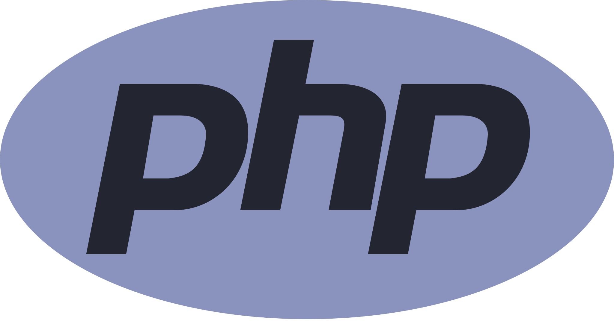

# PHP

Основной способ введения в PHP - хостинг типа beget.com, а также LAMP/XAMMP/OpenServer

 

Вам также понадобится аккаунт на github.com и некоторые базовые умения, такие как создание пулл-реквеста.
